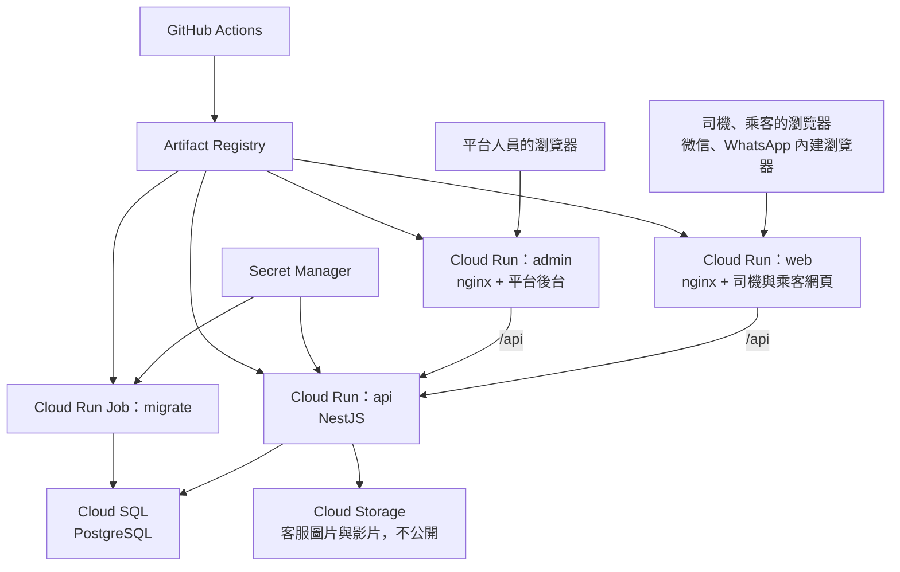

# 正式環境部署

部署方式沿用 Master Travel：Google Cloud Run、Cloud SQL、Artifact Registry、Secret Manager、Cloud Storage，由 GitHub Actions 自動發布。兩個專案的雲端資源完全分開，MasterDriver 使用獨立的 Google Cloud 專案 `master-driver-511510`，區域 `asia-east2`（香港）。

本文件只記錄架構與操作方式，不得寫入任何密碼、金鑰或 Secret 的內容（本倉庫公開）。

**目前狀態（2026-10-13）：已部署。**「一次性設定」全部完成，第一次部署由 GitHub Actions 執行成功，資料種子已執行。`DEPLOY_ENABLED` 已是 `true`：**之後每次推送到 `main` 都會自動部署正式環境。**

| 服務 | 正式網址（2026-10-14 起） | Cloud Run 原網址（仍可用） |
|---|---|---|
| 司機與乘客網頁 | `https://masterdriverapp.masterappinc.com` | `https://masterdriver-web-396289477283.asia-east2.run.app` |
| 平台後台 | `https://masterdriveradmin.masterappinc.com` | `https://masterdriver-admin-396289477283.asia-east2.run.app` |
| API | 只經上面網址的 `/api` 使用 | |

派單連結與乘客確認連結用正式網址產生（見下方「正式網域」）。還不能給人用，因為：

- 正式網域還沒在內地手機的微信內實測。
- 簡訊通道還沒設定，所以沒有人能登入（取得驗證碼會回 `SMS_NOT_CONFIGURED`）。

已完成的還有：資料種子、第一個超級管理員（帳號 `vincent`）、客服檔案的每日清理（Cloud Run Job `masterdriver-support-purge`，Cloud Scheduler 每天 04:30 香港時間觸發）。

**安全備註：**GitHub 到 Google Cloud 的登入限定為本倉庫、`production` 環境、`main` 分支；部署帳戶讀不到 Secret 的內容。能推送到本倉庫 `main` 的人就能部署正式環境，所以 masterappIT 帳號的密碼、兩步驗證與權杖要妥善保管。2026-10-13 曾因 Master Travel 倉庫的 `security-audit.yml` 懷疑帳號被盜用而暫緩接上 GitHub；使用者已確認帳號沒有被盜用。

## 分支

| 分支 | 用途 | 推送後 |
|---|---|---|
| `main` | 唯一的正式部署分支 | 品質閘門 → 自動部署正式環境 |
| `develop` | 開發整合 | 只執行品質閘門，不部署 |

與 Master Travel 相同：不另外建立 develop 專用的 API、資料庫或環境。功能在 `develop` 整合並通過品質閘門後，合併到 `main` 才上線。Pull request 一律執行品質閘門。

## 架構



| 服務 | 內容 | 說明 |
|---|---|---|
| `web` | `web/dist` + nginx | 搶單頁、乘客確認頁、司機端、客服頁；`/api/*` 轉給 API |
| `admin` | `admin/dist` + nginx | 平台後台；固定不給搜尋引擎收錄、不能被嵌入其他網站 |
| `api` | `backend/Dockerfile` | 所有驗證、權限、收費與搶單判斷。映像檔建置時下載當月的 DB-IP City Lite（數據流監控用來由 IP 推算地區，約 130 MB）；下載不到時照常建置，地區顯示「未知地區」 |
| `migrate`（Job） | 與 `api` 同一個映像檔 | 只執行 `prisma migrate deploy`；API 啟動時不會改資料庫結構 |

瀏覽器只連 `web` 或 `admin` 的網域，API 經同一網域的 `/api` 轉發，所以登入 cookie 是同站的，不需要 CORS。

### 快取

發布後用戶不用自己清微信快取：

- `index.html` 與所有頁面路徑 `no-store`；`/assets/` 的檔名帶內容雜湊，永久快取（`deploy/frontend/web.conf`、`admin.conf`）。下次打開或重新整理就是新版。
- 每個映像檔只有自己那一版的檔案，發布時還開著的頁面再切到沒載入過的頁面會找不到舊檔。網頁與後台遇到這種載入失敗會自動整頁重新載入到該頁一次（`web/src/stale-build.ts`、`admin/src/stale-build.ts`），30 秒內不重複，避免真的故障時不停重整。
- API 回應預設 `Cache-Control: no-store`（`backend/src/common/no-store.ts`），搶單頁輪詢的狀態不會被瀏覽器重用；Logo、名片頁照片、派單群二維碼、客服檔案各自設定較長的快取，會蓋過預設值。

## 發布流程

`.github/workflows/deploy-production.yml`，推送到 `main` 或手動執行時觸發：

1. 執行品質閘門（`verify:api`、資料庫整合測試、`verify:admin`、`verify:web`、部署腳本檢查），不通過就停止。
2. 以 Workload Identity Federation 登入 Google Cloud（GitHub 不保存任何 Google 金鑰）。
3. 建置 `web`、`admin`、`api` 三個映像檔並推送，之後一律以 `名稱@sha256:摘要` 指定，不使用 `latest`。
4. 建立 Cloud SQL 備份，失敗就停止。
5. 執行 migration Job，失敗就停止，並印出執行狀態與日誌。
6. 把 API 部署成不接流量的候選 revision，檢查 `/api/health/live` 與 `/api/health/ready`。
7. 檢查通過才把流量切到新 revision，並再次核對 revision、流量 100% 與映像檔摘要。
8. 部署 `web` 與 `admin`，同樣先不接流量，核對後才切換。

每次要改動正式環境（備份、migration、切流量、前端）之前，都會確認這個 commit 仍是 `main` 的最新一筆；排隊中的舊版本不會蓋掉新版本。

### 健康檢查

| 路徑 | 用途 |
|---|---|
| `GET /api/health/live` | 程序是否活著；Cloud Run 的啟動與存活探測用這個。資料庫出問題時不會讓平台不斷重啟服務 |
| `GET /api/health/ready` | 資料庫是否有回應；發布前檢查與外部監控用這個 |
| `GET /api/health` | 同 `ready`（舊路徑） |
| `GET /healthz` | `web`、`admin` 的 nginx 容器 |

### 資料庫變更的規則

API 與 migration 分開執行，新舊版本會短暫同時存在，所以 migration 必須向後相容：先加新結構、部署相容的程式，下一版才移除舊結構。正式環境不做自動還原（down migration）。

### 回滾

程式有問題時，把流量切回上一個確認過的 revision：

```bash
PROJECT_ID=master-driver-511510 REGION=asia-east2 SERVICE_NAME=masterdriver-api REVISION=<上一個 revision> ./deploy/cloud-run/rollback.sh
```

已執行的 migration 不會跟著還原；若結構仍向後相容就保留，否則優先用新版本修正。只有在資料完整性有風險、並宣告事故後，才考慮從備份還原。

## 一次性設定

以下由有權限的人執行一次。指令裡的名稱是建議值，可以更改，但要和 GitHub 變數一致。

```bash
export PROJECT_ID=master-driver-511510
export REGION=asia-east2
gcloud config set project "$PROJECT_ID"
```

### 1. 啟用服務

```bash
gcloud services enable run.googleapis.com sqladmin.googleapis.com secretmanager.googleapis.com \
  artifactregistry.googleapis.com iam.googleapis.com iamcredentials.googleapis.com sts.googleapis.com
```

### 2. 映像檔倉庫

```bash
gcloud artifacts repositories create masterdriver --repository-format=docker --location="$REGION"
```

### 3. 資料庫

```bash
gcloud sql instances create masterdriver-db --database-version=POSTGRES_16 --edition=enterprise --region="$REGION" \
  --tier=db-custom-1-3840 --storage-size=10 --storage-auto-increase --backup-start-time=19:00 \
  --enable-point-in-time-recovery --deletion-protection
gcloud sql databases create master_driver --instance=masterdriver-db
gcloud sql users create master_driver --instance=masterdriver-db --password="<自行產生的長密碼>"
```

規格是試點期間的建議值；**2026-10-13 起為了節省費用暫時降為 `db-g1-small`（共用核心，沒有服務水準保證），開始試點前要調回 `db-custom-1-3840`**（`gcloud sql instances patch masterdriver-db --tier=db-custom-1-3840`，資料庫會重啟一兩分鐘）。備份時間 19:00 UTC 是香港凌晨 3 點。`--edition=enterprise` 是必要的：PostgreSQL 16 預設的版本不接受自訂規格。執行個體建立後就持續計費，還沒有流量時可以先停用（`gcloud sql instances patch masterdriver-db --activation-policy=NEVER`），部署前再改回 `ALWAYS`。

### 4. Secret

```bash
# 資料庫連線：Cloud Run 以 Unix socket 連 Cloud SQL
printf 'postgresql://master_driver:<密碼>@localhost/master_driver?host=/cloudsql/%s:%s:masterdriver-db&schema=public' "$PROJECT_ID" "$REGION" \
  | gcloud secrets create masterdriver-database-url --data-file=-
# 驗證碼雜湊用的隨機字串
openssl rand -hex 32 | tr -d '\n' | gcloud secrets create masterdriver-otp-pepper --data-file=-
# 加密付款與簡訊金鑰用的金鑰。更換後，後台已儲存的金鑰會讀不出來，所以建立後不要重新產生。
openssl rand -base64 32 | tr -d '\n' | gcloud secrets create masterdriver-data-encryption-key --data-file=-
```

密碼若含 `@`、`/`、`:` 等符號，寫進連線字串前要先做 URL 編碼。

### 5. 客服媒體的儲存空間

```bash
gcloud storage buckets create "gs://${PROJECT_ID}-support-media" --location="$REGION" \
  --uniform-bucket-level-access --public-access-prevention
# 保險：程式每天清除超過 180 天的客服檔案，bucket 自己再在 200 天時刪除。
# 只限 support/ 路徑：同一個 bucket 的 profile/ 是名片頁的車輛照片，不能自動刪除。
cat > /tmp/lifecycle.json <<'JSON'
{"rule":[{"action":{"type":"Delete"},"condition":{"age":200,"matchesPrefix":["support/"]}}]}
JSON
gcloud storage buckets update "gs://${PROJECT_ID}-support-media" --lifecycle-file=/tmp/lifecycle.json
```

### 6. 服務帳戶與權限

四個帳戶各做各的事，互不通用：

| 帳戶 | 用途 | 權限 |
|---|---|---|
| `masterdriver-api` | API 執行時 | Cloud SQL Client；讀三個 Secret；客服 bucket 的 Object Admin |
| `masterdriver-migrate` | migration Job | Cloud SQL Client；只讀資料庫連線 Secret |
| `masterdriver-frontend` | `web`、`admin` 執行時 | 無 |
| `masterdriver-deploy` | GitHub Actions | 推送映像檔、更新 Cloud Run 服務與 Job、執行 Job、建立資料庫備份、讀日誌；**不能讀 Secret 的內容** |

```bash
for name in api migrate frontend deploy; do gcloud iam service-accounts create "masterdriver-$name"; done
sa() { printf 'masterdriver-%s@%s.iam.gserviceaccount.com' "$1" "$PROJECT_ID"; }

for name in api migrate; do
  gcloud projects add-iam-policy-binding "$PROJECT_ID" --member="serviceAccount:$(sa $name)" --role=roles/cloudsql.client --condition=None
  gcloud secrets add-iam-policy-binding masterdriver-database-url --member="serviceAccount:$(sa $name)" --role=roles/secretmanager.secretAccessor
done
for secret in masterdriver-otp-pepper masterdriver-data-encryption-key; do
  gcloud secrets add-iam-policy-binding "$secret" --member="serviceAccount:$(sa api)" --role=roles/secretmanager.secretAccessor
done
gcloud storage buckets add-iam-policy-binding "gs://${PROJECT_ID}-support-media" --member="serviceAccount:$(sa api)" --role=roles/storage.objectAdmin

for role in roles/run.admin roles/artifactregistry.writer roles/cloudsql.admin roles/logging.viewer; do
  gcloud projects add-iam-policy-binding "$PROJECT_ID" --member="serviceAccount:$(sa deploy)" --role="$role" --condition=None
done
# 部署帳戶要能指定另外三個帳戶來執行服務
for name in api migrate frontend; do
  gcloud iam service-accounts add-iam-policy-binding "$(sa $name)" --member="serviceAccount:$(sa deploy)" --role=roles/iam.serviceAccountUser
done
```

`roles/cloudsql.admin` 是為了建立備份，範圍比需要的大；之後可以改成只含 `cloudsql.backupRuns.create` 與 `cloudsql.instances.get` 的自訂角色。

### 7. GitHub 登入 Google Cloud（Workload Identity Federation）

只接受這個倉庫、`production` 環境、`main` 分支的工作流程：

```bash
gcloud iam workload-identity-pools create github --location=global
gcloud iam workload-identity-pools providers create-oidc github --location=global --workload-identity-pool=github \
  --issuer-uri=https://token.actions.githubusercontent.com \
  --attribute-mapping='google.subject=assertion.sub,attribute.repository=assertion.repository,attribute.environment=assertion.environment,attribute.ref=assertion.ref' \
  --attribute-condition="assertion.repository=='masterappIT/MasterDriver' && assertion.environment=='production' && assertion.ref=='refs/heads/main'"
PROJECT_NUMBER="$(gcloud projects describe "$PROJECT_ID" --format='value(projectNumber)')"
gcloud iam service-accounts add-iam-policy-binding "$(sa deploy)" --role=roles/iam.workloadIdentityUser \
  --member="principalSet://iam.googleapis.com/projects/${PROJECT_NUMBER}/locations/global/workloadIdentityPools/github/attribute.repository/masterappIT/MasterDriver"
```

### 8. GitHub 設定

在倉庫建立 `production` 環境，把「可部署的分支」限定為 `main`。Master Travel 的做法是再加上必須有人核准才部署；要不要加由您決定，加了之後推送到 `main` 會等核准才部署。

`production` 環境的變數（都不是秘密）：

| 變數 | 值 |
|---|---|
| `GCP_PROJECT_ID` | `master-driver-511510` |
| `GCP_REGION` | `asia-east2` |
| `GCP_ARTIFACT_REPOSITORY` | `masterdriver` |
| `GCP_WORKLOAD_IDENTITY_PROVIDER` | `projects/<專案編號>/locations/global/workloadIdentityPools/github/providers/github` |
| `GCP_DEPLOY_SERVICE_ACCOUNT` | `masterdriver-deploy@master-driver-511510.iam.gserviceaccount.com` |
| `GCP_RUNTIME_SERVICE_ACCOUNT` | `masterdriver-api@…` |
| `GCP_MIGRATION_SERVICE_ACCOUNT` | `masterdriver-migrate@…` |
| `GCP_FRONTEND_SERVICE_ACCOUNT` | `masterdriver-frontend@…` |
| `GCP_SQL_INSTANCE_NAME` | `masterdriver-db` |
| `GCP_CLOUD_SQL_CONNECTION_NAME` | `master-driver-511510:asia-east2:masterdriver-db`（用指令設定時整個值要加單引號：zsh 會把變數後面的 `:a` 當成修飾符而改掉內容，第一次部署就是因此失敗） |
| `GCP_DATABASE_URL_SECRET` | `masterdriver-database-url` |
| `GCP_OTP_PEPPER_SECRET` | `masterdriver-otp-pepper` |
| `GCP_DATA_ENCRYPTION_KEY_SECRET` | `masterdriver-data-encryption-key` |
| `GCP_SUPPORT_MEDIA_BUCKET` | `master-driver-511510-support-media` |
| `GCP_API_SERVICE` | `masterdriver-api` |
| `GCP_MIGRATION_JOB` | `masterdriver-migrate` |
| `GCP_WEB_SERVICE` | `masterdriver-web` |
| `GCP_ADMIN_SERVICE` | `masterdriver-admin` |
| `GCP_FOLLOWING_JOBS` | `masterdriver-support-purge`（以空白分隔；發布時跟著換成新映像檔的 Job） |
| `PRODUCTION_WEB_URL` | 司機與乘客網頁的正式網址，例如 `https://<正式網域>`，結尾不加 `/`。派單連結與乘客確認連結用這個網址產生 |

**倉庫**層級的變數（不是環境變數，因為要在進入環境之前判斷）：

| 變數 | 值 |
|---|---|
| `DEPLOY_ENABLED` | 以上全部完成後設為 `true`。沒有設定時，推送到 `main` 只執行品質閘門 |

### 9. 第一次部署之後

```bash
# 功能目錄、方案與上線全站免費期（可重複執行）
gcloud run jobs deploy masterdriver-seed --region="$REGION" --image="<本次發布的 api 映像檔>" \
  --service-account="$(sa migrate)" --set-cloudsql-instances="${PROJECT_ID}:${REGION}:masterdriver-db" \
  --set-secrets=DATABASE_URL=masterdriver-database-url:latest \
  --command=npx --args=tsx,/app/prisma/seed.ts --max-retries=0
gcloud run jobs execute masterdriver-seed --region="$REGION" --wait
```

- **第一個超級管理員**（已完成）：`npm run admin -- --create …` 會把一次性密碼印出來，所以不要用 Cloud Run Job 執行（密碼會進入日誌）。做法是在自己的電腦用 Cloud SQL Auth Proxy 連到正式資料庫，把輸出導到一個只有自己讀得到、不進 Git 的檔案：

  ```bash
  gcloud components install cloud-sql-proxy
  cloud-sql-proxy --gcloud-auth --port 5440 master-driver-511510:asia-east2:masterdriver-db &
  # DATABASE_URL 用 Secret 裡的帳號密碼，主機改成 127.0.0.1:5440；不要把它印出來或寫進檔案
  npm run admin -- --create --username=<帳號> --name="<顯示名稱>" --role=SUPER_ADMIN > .data/production-admin-password.txt 2>&1
  ```

  登入後立即到「修改密碼」更換，然後刪除那個檔案。之後的帳號在後台「後台帳號」頁建立。
- **客服檔案清理**（已完成）：Job `masterdriver-support-purge` 使用 API 的映像檔，指令是 `node dist/cli/support-media.js --purge`（映像檔裡只有編譯後的程式，沒有 `src/`），由服務帳戶 `masterdriver-scheduler` 透過 Cloud Scheduler 每天觸發。環境變數 `GCP_FOLLOWING_JOBS` 列出這類 Job，每次發布會把它們的映像檔換成新版本。
- **簡訊與付款通道**：在後台設定；上線前確認「登入配置 → 開發模式登入」是關閉的。

## 正式網域

2026-10-14 設定完成：

| 網域 | 指向 |
|---|---|
| `masterdriverapp.masterappinc.com` | 司機與乘客網頁（Cloud Run `masterdriver-web`） |
| `masterdriveradmin.masterappinc.com` | 平台後台（Cloud Run `masterdriver-admin`） |

**為什麼用負載平衡器：**Cloud Run 的自訂網域對應不支援 `asia-east2`（2026-10-14 查 Google Cloud 文件確認），所以在前面加了全球外部 HTTPS 負載平衡器，做法照同公司 MasterBox（`masterbox-507211`）現有的那一套，但資源完全在本專案，不與 MasterBox 共用。

| 資源（`master-driver-511510`，全球） | 用途 |
|---|---|
| `masterdriver-public-ip` | 固定 IP `34.144.204.172`（Premium） |
| `masterdriver-web-neg`、`masterdriver-admin-neg` | serverless NEG（`asia-east2`），指向兩個 Cloud Run 服務 |
| `masterdriver-web-backend`、`masterdriver-admin-backend` | 後端服務（`EXTERNAL_MANAGED`、HTTP） |
| `masterdriver-map` | 依主機名稱分流；其他主機名稱一律到 `web` |
| `masterdriver-cert` | Google 代管憑證，涵蓋兩個網域，自動續期 |
| `masterdriver-https-proxy`、`masterdriver-https-rule` | 443 |
| `masterdriver-http-redirect`、`masterdriver-http-proxy`、`masterdriver-http-rule` | 80，一律 301 轉到 `https://`（MasterBox 沒有這一段） |

**DNS：**`masterappinc.com` 在 Squarespace 註冊，DNS 也在 Squarespace（公司官網、Mailgun 郵件、MasterBox 子網域都在同一份紀錄）。只新增了兩筆 A 紀錄 `masterdriverapp`、`masterdriveradmin` → `34.144.204.172`，TTL 4 小時；其他紀錄沒有變動。改 DNS 要在 Squarespace 後台以 `info@masterappinc.com` 登入，每次新增紀錄都要再用 Google 驗證一次。DNS 是否搬到 Google Cloud DNS 另行處理：整份紀錄屬於公司，不應放在本專案。

**連結：**GitHub `production` 環境的 `PRODUCTION_WEB_URL` 已改為 `https://masterdriverapp.masterappinc.com`，部署時寫入 API 的 `PUBLIC_BASE_URL`。改這個變數後要重新部署才生效。

**費用：**負載平衡器每月約 18 到 25 美元，另加流量費用。

要留意的事：

- `*.run.app` 原網址仍可直接使用；使用者回報內地可以打開。正式網域走 Google 的負載平衡器 IP，**還沒在內地手機的微信內實測**（見 [ACCEPTANCE.md](./ACCEPTANCE.md)）。不穩的話要改用其他入口（例如在香港的反向代理）。
- 微信內分享連結時，未在微信登記的網域可能出現提示頁；是否需要做微信的網域驗證，在實測時一併確認。
- 後台「SEO」的正式網域要填 `https://masterdriverapp.masterappinc.com`（在後台操作）。

## 已在正式環境驗證（2026-10-13）

- 完整的發布流程：品質閘門、三個映像檔、資料庫備份、migration Job、API 部署與健康檢查、兩個前端。第一次（建立服務）與第二次（新版本先不接流量、檢查通過才切換，清理 Job 跟著換映像檔）兩條路徑都由推送 `main` 實際跑過。
- 資料種子 Job 執行成功。
- 經 `web` 網址的 `/api` 轉發、SPA 路徑、`robots.txt`、`admin` 網址。
- 客服檔案：以訪客身分上傳一張圖片，寫入私有 bucket 後讀回內容完全相同；不帶憑證讀取回 401。（留下一則測試對話和一個 39 位元組的測試檔。）
- 正式網域（2026-10-14，在開發用的電腦上以 curl 測試）：兩個網域的 `https://` 首頁與 `/api/health/ready` 都回 200；`http://` 回 301 轉到 `https://`；API 的 `PUBLIC_BASE_URL` 已是正式網址。

## 尚未驗證

- 回滾腳本沒有實際執行過。
- 正式網域在內地的連線，以及微信與 WhatsApp 內的操作。
- 影片上傳（只驗證了圖片）。客服檔案清理 Job 與排程已實際觸發成功，但當時沒有過期檔案可刪。
- 從本機推送 API 映像檔會因上傳逾時失敗（映像檔約 780 MB），部署一律由 GitHub Actions 執行。

## 相關檔案

- `.github/workflows/deploy-production.yml`、`.github/workflows/quality-gates.yml`
- `backend/Dockerfile`、`.dockerignore`
- `deploy/frontend/`：`Dockerfile`、`web.conf`、`admin.conf`、`build-image.sh`、`deploy.sh`
- `deploy/cloud-run/`：`deploy.sh`、`smoke-test.sh`、`rollback.sh`、`revision-ready.py`
